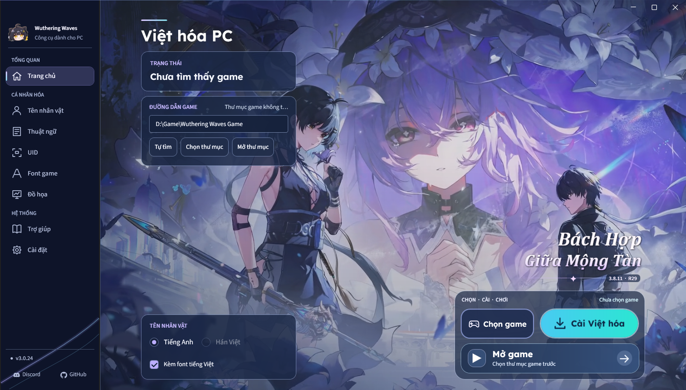

# Việt hóa Wuthering Waves (WuWa) — PC

**Cài tiếng Việt cho Wuthering Waves trên Windows 10/11 (64-bit)**. Hỗ trợ chọn thư mục game, cài hoặc gỡ bản dịch, tùy chỉnh phông chữ và mở game từ ứng dụng.

**[Tải Việt hóa PC mới nhất](https://github.com/WahuVN/Viet-Hoa-WuWa/releases/latest)** · [Hướng dẫn](HUONG_DAN_TAI_DUNG_GOI.md) · [Discord hỗ trợ](https://discord.gg/Gy5YQ84Yc2)

## Giao diện ứng dụng

Trang chủ tự vừa kích thước cửa sổ, **không cần cuộn để tìm nút Cài Việt hóa hoặc Mở game**. Các công cụ chỉnh sửa và thiết lập vẫn nằm trong menu bên trái.

## Tải đúng phiên bản

| Nền tảng | Bản phát hành | Ghi chú |
| --- | --- | --- |
| **Windows PC** | [WuWa Việt Hóa v3.0.24](https://github.com/WahuVN/Viet-Hoa-WuWa/releases/latest) | R29, dữ liệu 3.8.11, tên nhân vật tiếng Anh |
| **Android** | [VHWuWa Mobile alpha.24](https://github.com/WahuVN/VHWuWa-Mobile/releases/tag/v0.2.0-alpha.24) | Bản thử nghiệm R28, yêu cầu Shizuku |
| **Công cụ dịch thuật** | [App-Dich-WuWa v3.0.16](https://github.com/WahuVN/Viet-Hoa-WuWa/releases/tag/v3.0.16) | Dành cho dịch giả; không phải bộ cài game |

## Cách cài Việt hóa PC

1. Tải ZIP **VietHoa-WuWa-v3.0.24.zip** từ [Releases](https://github.com/WahuVN/Viet-Hoa-WuWa/releases/latest), giải nén và chạy `VHWuWa.exe`.
2. Đóng game, dùng **Tự tìm** hoặc **Chọn game** để chọn thư mục Wuthering Waves có thư mục `Client`.
3. Bấm **Cài Việt hóa**; có thể giữ tên nhân vật tiếng Anh và dùng font tiếng Việt.
4. Bấm **Mở game**, sau đó nhấn **Start** trong launcher. Trong game chọn ngôn ngữ chữ **English**.

Khi có phiên bản mới, mở **Cài đặt → Kiểm tra cập nhật**. Bản R29 hiện chưa có gói tên Hán Việt được phát hành.

## Chức năng chính

- **Việt hóa PC:** cài, kiểm tra, cập nhật hoặc gỡ bản dịch.
- **Tùy chỉnh:** font tiếng Việt, tên nhân vật, thuật ngữ, UID và đồ họa.
- **Khởi chạy:** mở game qua launcher chính thức hoặc Steam; có thao tác đóng game kèm xác nhận.
- **Công cụ biên dịch:** hỗ trợ rà soát thuật ngữ và kiểm tra bản dịch qua ứng dụng riêng.

## Hỗ trợ và mã nguồn

[Hướng dẫn chi tiết](HUONG_DAN_TAI_DUNG_GOI.md) · [Lịch sử phiên bản](docs/releases/README.md) · [Báo lỗi](https://github.com/WahuVN/Viet-Hoa-WuWa/issues) · [Discord](https://discord.gg/Gy5YQ84Yc2)

*Đây là công cụ do cộng đồng phát triển, không thuộc nhà phát hành Wuthering Waves. Hãy tải ứng dụng từ trang Releases của repository này.*
